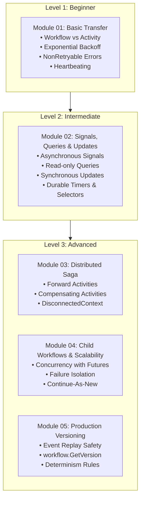

# Temporal for Go Software Engineers: Zero-to-Advanced Masterclass

[](https://go.dev)
[](https://docs.temporal.io)
[](file:///home/umesh-pc/Desktop/workspace/temporal)

This repository is an end-to-end practical learning curriculum and production-ready reference for building distributed systems with [Temporal](https://github.com/temporalio/temporal) using Go.

> [!IMPORTANT]
> **No Local Server Setup Required!**
> You do **not** need to install, configure, or run a Temporal Server, Cassandra, PostgreSQL, or Docker cluster on your local machine.
> - **In-Memory Testing:** All modules include comprehensive tests using `go.temporal.io/sdk/testsuite` that execute full workflows in-memory in milliseconds with zero dependencies.
> - **Remote / Cloud Service:** Both the [`cmd/worker`](file:///home/umesh-pc/Desktop/workspace/temporal/cmd/worker/main.go) and [`cmd/starter`](file:///home/umesh-pc/Desktop/workspace/temporal/cmd/starter/main.go) CLI are pre-configured to connect directly to **Temporal Cloud** or any remote managed Temporal Service using mTLS or API Keys via environment variables.

---

## 📚 Study Materials & Documentation

| Document | Topic | Description |
| :--- | :--- | :--- |
| **[01. Core Concepts](file:///home/umesh-pc/Desktop/workspace/temporal/docs/01_core_concepts.md)** | Architecture & Foundations | Durable Execution, Event Sourcing, Replay mechanism, and Determinism Rules. |
| **[02. Connecting to Cloud](file:///home/umesh-pc/Desktop/workspace/temporal/docs/02_connecting_to_cloud.md)** | Managed Services | How to connect to Temporal Cloud or remote clusters via mTLS, API Keys, and env vars. |
| **[03. Patterns Guide](file:///home/umesh-pc/Desktop/workspace/temporal/docs/03_patterns_guide.md)** | Design Patterns | Deep dive into Retries, Signals, Queries, Updates, Sagas, Child Workflows, and Versioning. |
| **[04. Testing Without Server](file:///home/umesh-pc/Desktop/workspace/temporal/docs/04_testing_without_server.md)** | Zero-Server Testing | Unit testing with `testsuite.WorkflowTestSuite`, time-skipping, and mock activities. |
| **[05. Production Architecture](file:///home/umesh-pc/Desktop/workspace/temporal/docs/05_production_architecture_design.md)** | Enterprise Architecture | End-to-end topology, VPC boundaries, K8s auto-scaling, mTLS & payload encryption. |

---

## 🗺️ Project Structure & Learning Curriculum

```text
temporal/
├── README.md                      # Central Guide & Architecture
├── docs/                          # Detailed Software Engineering Study Material
│   ├── 01_core_concepts.md
│   ├── 02_connecting_to_cloud.md
│   ├── 03_patterns_guide.md
│   └── 04_testing_without_server.md
├── config/
│   └── client.go                  # Universal client builder (Cloud mTLS, API Key, remote endpoints)
├── internal/
│   ├── 01_basic_transfer/         # Beginner: Basic Workflow + Activity with Retries & Heartbeats
│   │   ├── activity.go
│   │   ├── workflow.go
│   │   └── workflow_test.go       # Zero-server test
│   ├── 02_signals_and_queries/    # Intermediate: Order Processing with Signals, Queries & Updates
│   │   ├── activity.go
│   │   ├── workflow.go
│   │   └── workflow_test.go
│   ├── 03_saga_distributed_tx/    # Advanced: Trip Booking Saga with Compensating Transactions
│   │   ├── activity.go
│   │   ├── workflow.go
│   │   └── workflow_test.go
│   ├── 04_child_workflows_cron/   # Advanced: Child Workflows, Parallelism & Continue-As-New
│   │   ├── activity.go
│   │   ├── workflow.go
│   │   └── workflow_test.go
│   └── 05_versioning/             # Advanced: Safe Code Evolution with workflow.GetVersion
│       ├── workflow.go
│       └── workflow_test.go
└── cmd/
    ├── worker/                    # Worker daemon connecting to Cloud / Remote Service
    │   └── main.go
    └── starter/                   # Interactive CLI to trigger, signal, query, and test workflows
        └── main.go
```

---

## ⚡ Quickstart: Run All Tests (Zero Server Required)

Run the entire suite of in-memory workflow tests right now without any server infrastructure:

```bash
go test -v ./...
```

Expected output:
```text
ok  	github.com/umesh-pc/temporal-learning/internal/01_basic_transfer	0.043s
ok  	github.com/umesh-pc/temporal-learning/internal/02_signals_and_queries	0.044s
ok  	github.com/umesh-pc/temporal-learning/internal/03_saga_distributed_tx	0.047s
ok  	github.com/umesh-pc/temporal-learning/internal/04_child_workflows_cron	0.053s
ok  	github.com/umesh-pc/temporal-learning/internal/05_versioning	0.048s
```

All 5 modules run and verify their state machines, retries, compensations, and determinism in **under 0.25 seconds**!

---

## 🚀 Connecting to Temporal Cloud / Remote Service

To run the Worker and trigger workflows against **Temporal Cloud** or a remote managed service:

### 1. Set Your Environment Variables
```bash
# Option A: Temporal Cloud with mTLS (Standard)
export TEMPORAL_HOST_PORT="your-namespace.a1b2c.tmprl.cloud:7233"
export TEMPORAL_NAMESPACE="your-namespace.a1b2c"
export TEMPORAL_TLS_CERT_PATH="/path/to/client.pem"
export TEMPORAL_TLS_KEY_PATH="/path/to/client.key"

# Option B: Temporal Cloud with API Key
export TEMPORAL_HOST_PORT="your-namespace.a1b2c.tmprl.cloud:7233"
export TEMPORAL_NAMESPACE="your-namespace.a1b2c"
export TEMPORAL_API_KEY="tmprl_apikey_xxxxxxxxxxxxxxxx"

# Option C: Shared Remote Cluster (Insecure/Internal)
export TEMPORAL_HOST_PORT="temporal.company.internal:7233"
export TEMPORAL_NAMESPACE="default"
export TEMPORAL_INSECURE="true"
```

### 2. Start the Worker Process
```bash
go run ./cmd/worker
```
The worker registers all workflows and activities across all 5 modules and polls the configured Task Queue (`TEMPORAL_LEARNING_TASK_QUEUE`).

### 3. Use the Starter CLI to Interact with the Service
Open another terminal:
```bash
# 1. Trigger Basic Money Transfer:
go run ./cmd/starter transfer

# 2. Trigger Order Approval Workflow:
go run ./cmd/starter order

# 3. Query the Running Order Workflow:
go run ./cmd/starter query <order-workflow-id>

# 4. Mutate Address on Running Workflow via Update:
go run ./cmd/starter update <order-workflow-id> "789 Broadway Ave, New York, NY"

# 5. Send External Approval Signal:
go run ./cmd/starter signal <order-workflow-id> yes

# 6. Trigger Saga Distributed Transaction (with simulated Car failure and automatic rollback):
go run ./cmd/starter saga --fail

# 7. Trigger Concurrent Child Workflows Batch:
go run ./cmd/starter batch

# 8. Trigger Versioned Workflow:
go run ./cmd/starter version
```

---

## 🧠 Architectural Deep Dive by Module



### 1. [Module 01: Basic Fund Transfer](file:///home/umesh-pc/Desktop/workspace/temporal/internal/01_basic_transfer)
- **Problem Solved:** How to execute two-step operations where Step 2 might fail due to network glitches without leaving money in limbo.
- **Key Concepts:**
  - `workflow.ActivityOptions` configuring `StartToCloseTimeout` and `RetryPolicy`.
  - Distinguishing retryable errors from `temporal.NewNonRetryableApplicationError`.
  - `activity.RecordHeartbeat` to report progress on long operations.

### 2. [Module 02: Signals, Queries, and Updates](file:///home/umesh-pc/Desktop/workspace/temporal/internal/02_signals_and_queries)
- **Problem Solved:** How to interact with long-running business processes (human-in-the-loop approvals, address corrections, live order tracking).
- **Key Concepts:**
  - `workflow.GetSignalChannel`: Receive asynchronous push events.
  - `workflow.SetQueryHandler`: Instant read-only state inspection.
  - `workflow.SetUpdateHandlerWithOptions`: Synchronous validation and state mutation with immediate feedback.
  - `workflow.NewSelector`: Deterministically multiplexing signals, timers, and futures.

### 3. [Module 03: The Saga Pattern](file:///home/umesh-pc/Desktop/workspace/temporal/internal/03_saga_distributed_tx)
- **Problem Solved:** Coordinating multi-service operations (Flight + Hotel + Car) where later steps can fail, requiring automatic rollback.
- **Key Concepts:**
  - Building a LIFO compensation stack.
  - Using `workflow.NewDisconnectedContext(ctx)` so rollback activities execute even when the workflow is cancelled or timed out.

### 4. [Module 04: Child Workflows & Continue-As-New](file:///home/umesh-pc/Desktop/workspace/temporal/internal/04_child_workflows_cron)
- **Problem Solved:** Large-scale batch processing and infinite recurring monitoring loops.
- **Key Concepts:**
  - Concurrently launching Child Workflows with `workflow.ExecuteChildWorkflow` and futures.
  - `workflow.NewContinueAsNewError` to reset the 50,000 event history limit on recurring jobs.

### 5. [Module 05: Safe Versioning](file:///home/umesh-pc/Desktop/workspace/temporal/internal/05_versioning)
- **Problem Solved:** How to safely change workflow code in production without crashing running workflows during replay.
- **Key Concepts:**
  - `workflow.GetVersion(ctx, changeID, minVersion, maxVersion)` to branch code safely based on execution generation.

---

## 🛡️ The Golden Rules of Workflow Determinism

When writing Temporal Workflow code in Go, keep this checklist on your desk:

| ❌ NEVER DO THIS IN A WORKFLOW | ✅ ALWAYS DO THIS INSTEAD |
| :--- | :--- |
| `http.Get("https://api.com")` | Put HTTP / API calls inside an **Activity** |
| `db.Query("SELECT ...")` | Put Database operations inside an **Activity** |
| `time.Now()` | `workflow.Now(ctx)` |
| `time.Sleep(5 * time.Second)` | `workflow.Sleep(ctx, 5 * time.Second)` |
| `go myGoroutine()` | `workflow.Go(ctx, func(gCtx workflow.Context) { ... })` |
| `rand.Intn(100)` | `workflow.SideEffect(ctx, func(ctx) interface{} { return rand.Intn(100) })` |
| `make(chan struct{})` | `workflow.NewChannel(ctx)` |
| Mutating global package variables | Store all state within local workflow variables or return types |

---

## 📖 Official Documentation Links

- [Temporal Official Docs](https://docs.temporal.io)
- [Temporal Go SDK Developer Guide](https://docs.temporal.io/dev-guide/go-sdk)
- [Temporal Cloud Guide](https://docs.temporal.io/cloud)
- [Temporal Go SDK GitHub Repository](https://github.com/temporalio/sdk-go)
- [Temporal Server GitHub Repository](https://github.com/temporalio/temporal)
