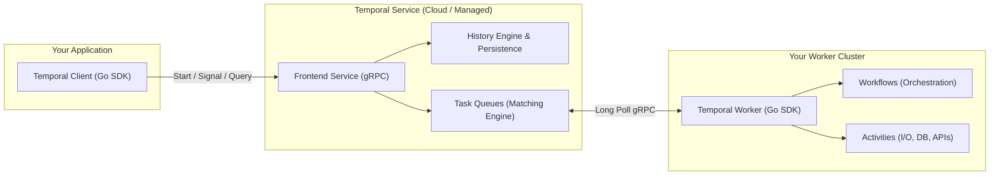

# Module 01: Temporal Core Concepts & Architecture

> **Official Documentation Reference:** [https://docs.temporal.io/evaluate/major-components](https://docs.temporal.io/evaluate/major-components)

---

## 1. What is Temporal?

In traditional software engineering, building reliable distributed applications requires stitching together databases, message brokers, queues, cron engines, and custom retry logic to handle partial failures:

```
[Service A] ---> (Kafka/RabbitMQ) ---> [Service B] ---> [Database]
     |                                      |
   Crash?                                Network
  Lost State?                            Partition?
```

When a network partition occurs, a database deadlocks, or a microservice pod restarts midway through a transaction, you face **dual-write anomalies**, **inconsistent state**, and **hung workflows**.

**Temporal provides Durable Execution**:
A programming model where code execution is automatically persisted, fault-tolerant, and stateful. If the server crashes, the network disconnects, or the worker node burns down, the execution resumes exactly from the last saved step as if nothing ever happened.

---

## 2. Core Architecture



### The Three Roles:
1. **Temporal Service (Server / Cloud)**:
   - Does **NOT** execute your business code.
   - Manages state, event history, timers, retries, and task queues.
   - Can be fully hosted as **Temporal Cloud** so you never manage clusters, databases, or daemons.
2. **Temporal Worker**:
   - Hosted by **you** in your own environment (Kubernetes, Docker, VM, serverless).
   - Long-polls the Temporal Service via gRPC for tasks.
   - Executes your Workflow and Activity code.
3. **Temporal Client**:
   - Used by your web servers, APIs, or CLI tools to start workflows, send signals, and query state.

---

## 3. Workflows vs. Activities

| Characteristic | Workflow | Activity |
| :--- | :--- | :--- |
| **Purpose** | Deterministic Orchestration | Non-deterministic Execution (I/O) |
| **Allowed Code** | Pure business logic, timers, signals | HTTP calls, DB queries, third-party APIs |
| **Failure Mode** | Does not fail on crash; replays | Retries automatically via RetryPolicy |
| **State** | In-memory state is durable | Ephemeral per execution attempt |
| **Context** | `workflow.Context` | standard `context.Context` |

---

## 4. The Golden Rules of Workflow Determinism

When a Temporal Worker restarts or resumes after a crash, Temporal uses **Event Sourcing & Replay**: it plays back the recorded history of events into your workflow code to reconstruct the state.

> [!CAUTION]
> **Deterministic Rule**: If your workflow runs against the same Event History multiple times, it **MUST take the exact same branch and sequence of decisions every time**.

### What is FORBIDDEN in Workflow Code:
- ❌ **No direct I/O**: Never call `http.Get()`, query a database, or read local files. Put them in an Activity!
- ❌ **No `time.Now()`**: Use `workflow.Now(ctx)`. (History records the exact timestamp).
- ❌ **No standard `time.Sleep()`**: Use `workflow.Sleep(ctx, duration)`.
- ❌ **No standard Go routines (`go func()`)**: Use `workflow.Go(ctx, func(gCtx workflow.Context) { ... })`.
- ❌ **No random numbers (`rand.Intn()`)**: Use `workflow.SideEffect()` or generate in an Activity.
- ❌ **No standard Go channels (`make(chan T)`)**: Use `workflow.NewChannel(ctx)` or `workflow.GetSignalChannel()`.
- ❌ **No global mutable state**: Workflows must not read or mutate global package variables.

---

## 5. Activity Timeouts & Retries

Temporal activities are configured with precise timeouts:

```go
activityOptions := workflow.ActivityOptions{
    // Maximum time allowed for a single execution attempt:
    StartToCloseTimeout: 10 * time.Second,

    // Maximum total time including all retries and queuing:
    ScheduleToCloseTimeout: 2 * time.Minute,

    // Heartbeat timeout for long-running activities:
    HeartbeatTimeout: 5 * time.Second,

    // Exponential backoff retry policy:
    RetryPolicy: &temporal.RetryPolicy{
        InitialInterval:    1 * time.Second,
        BackoffCoefficient: 2.0,
        MaximumInterval:    30 * time.Second,
        MaximumAttempts:    5,
        NonRetryableErrorTypes: []string{
            "ErrInvalidInput",
            "ErrInsufficientFunds",
        },
    },
}
ctx = workflow.WithActivityOptions(ctx, activityOptions)
```

### Transient vs Fatal Errors:
- **Retryable Errors** (e.g. network timeout, 503 gateway): Return standard `fmt.Errorf(...)`. Temporal will automatically back off and retry.
- **Non-Retryable Errors** (e.g. invalid credit card, bad input): Return `temporal.NewNonRetryableApplicationError("reason", "ErrType", nil)`. Temporal aborts immediately without wasting retry attempts.
