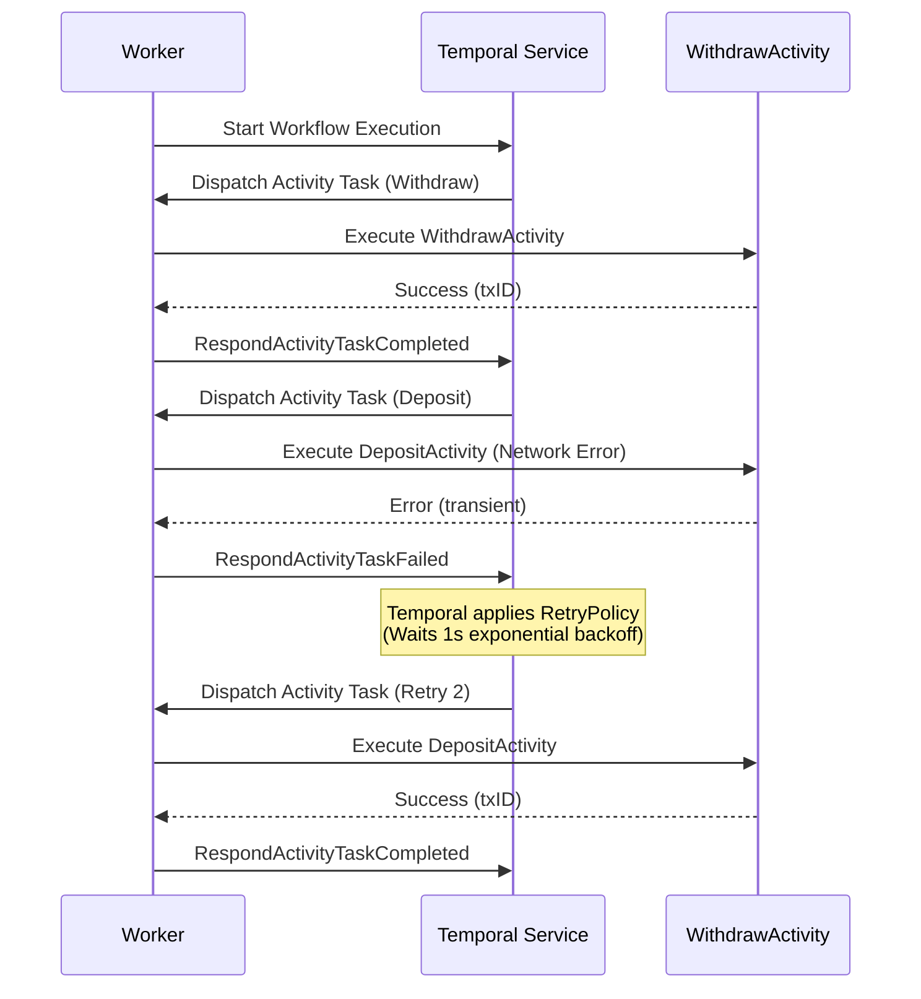
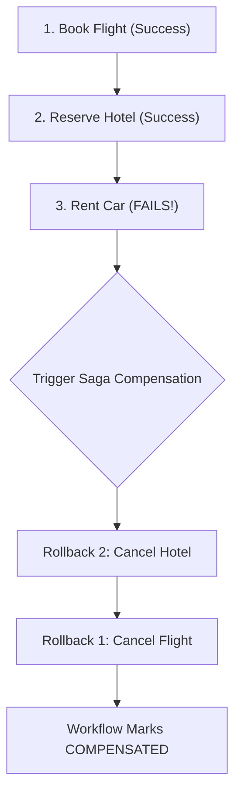

# Module 03: Engineering Patterns Guide (Beginner to Advanced)

> **Official Documentation Reference:** [https://docs.temporal.io/dev-guide/go-sdk](https://docs.temporal.io/dev-guide/go-sdk)

---

## Pattern 1: Basic Orchestration & Retries (Beginner)

**File Reference:** [`internal/01_basic_transfer/`](file:///home/umesh-pc/Desktop/workspace/temporal/internal/01_basic_transfer)

In traditional code, handling network errors requires manual retry loops and exponential backoff calculations that clutter business logic. In Temporal, retries are declaratively configured on the `workflow.Context`.



### Key Engineering Takeaway:
- Use `temporal.NewNonRetryableApplicationError()` for permanent domain errors (e.g. invalid credentials, insufficient balance) to avoid wasteful retries.
- Use `activity.RecordHeartbeat()` inside long-running batch activities so Temporal detects worker node failures before the full timeout expires.

---

## Pattern 2: Signals, Queries, and Updates (Intermediate)

**File Reference:** [`internal/02_signals_and_queries/`](file:///home/umesh-pc/Desktop/workspace/temporal/internal/02_signals_and_queries)

How do external systems communicate with a running, long-lived workflow?

| Mechanism | Sync/Async | Mutates State? | Appends to History? | Return Value | Use Case |
| :--- | :--- | :--- | :--- | :--- | :--- |
| **Signal** | Asynchronous | Yes | Yes | None (Void) | External events (webhooks, human approvals) |
| **Query** | Synchronous | No (Read-Only) | No | Typed data | State inspection (dashboard, status check) |
| **Update** | Synchronous | Yes | Yes | Typed data + Error | Immediate mutation + validation + confirmation |

```go
// Registering Query:
workflow.SetQueryHandler(ctx, "query_order_state", func() (*OrderState, error) {
    return state, nil
})

// Registering Update with validation:
workflow.SetUpdateHandlerWithOptions(ctx, "update_address",
    func(ctx workflow.Context, newAddress string) (string, error) {
        state.ShippingAddress = newAddress
        return "Updated successfully", nil
    },
    workflow.UpdateHandlerOptions{
        Validator: func(ctx workflow.Context, addr string) error {
            if len(addr) < 5 { return errors.New("address too short") }
            return nil
        },
    },
)

// Awaiting Signal or Deadline with Selector:
selector := workflow.NewSelector(ctx)
selector.AddReceive(signalChan, func(c workflow.ReceiveChannel, more bool) { ... })
selector.AddFuture(timerFuture, func(f workflow.Future) { ... })
selector.Select(ctx)
```

---

## Pattern 3: The Saga Pattern for Distributed Transactions (Advanced)

**File Reference:** [`internal/03_saga_distributed_tx/`](file:///home/umesh-pc/Desktop/workspace/temporal/internal/03_saga_distributed_tx)

When coordinating actions across multiple independent microservices (e.g. Flights, Hotels, Car Rentals), standard ACID transactions across services are impossible. The **Saga Pattern** solves this by maintaining a sequence of compensating activities to rollback forward steps if any subsequent step fails.



### Critical Temporal Requirement: `workflow.NewDisconnectedContext`
When a workflow fails or receives a cancellation signal, the parent `ctx` is already cancelled. If you attempt to execute compensating activities using the cancelled `ctx`, Temporal will immediately cancel them!

You **must** use `NewDisconnectedContext`:
```go
disconnectedCtx, _ := workflow.NewDisconnectedContext(ctx)
compCtx := workflow.WithActivityOptions(disconnectedCtx, activityOptions)

// Run compensations in LIFO order
for i := len(compensations) - 1; i >= 0; i-- {
    _ = compensations[i](compCtx)
}
```

---

## Pattern 4: Child Workflows & Concurrency (Advanced)

**File Reference:** [`internal/04_child_workflows_cron/`](file:///home/umesh-pc/Desktop/workspace/temporal/internal/04_child_workflows_cron)

### Why Use Child Workflows?
1. **Failure Domain Isolation**: A failure in one child does not corrupt the parent workflow's state.
2. **Compact Event History**: High-throughput workflows (e.g. processing 10,000 orders) will breach Temporal's 50,000 event history limit if executed in a single workflow. Delegating to child workflows distributes history across multiple execution trees.
3. **Independent Lifecycle**: Child workflows can continue running even after the parent terminates if configured with `ParentClosePolicy: Abandon`.

```go
// Concurrently spawning child workflows:
futures := make([]workflow.ChildWorkflowFuture, len(items))
for i, item := range items {
    futures[i] = workflow.ExecuteChildWorkflow(childCtx, ItemProcessorChildWorkflow, item)
}

// Awaiting all child futures:
for _, f := range futures {
    var res ProcessResult
    err := f.Get(ctx, &res)
}
```

---

## Pattern 5: Continue-As-New for Infinite Loops (Advanced)

Temporal enforces a strict ceiling of **50,000 events** (or 50MB) per workflow execution history. If a workflow runs an infinite loop (e.g. recurring sensor polling, bot monitor, subscription billing), the history will eventually exceed this limit and fail.

**Continue-As-New** cleanly resets the history while preserving the Workflow ID:

```go
func RecurringMonitorWorkflow(ctx workflow.Context, state RecurringState) (string, error) {
    // Perform cycle work...
    workflow.Sleep(ctx, 1*time.Hour)
    state.Iteration++

    // Reset history and continue:
    return "", workflow.NewContinueAsNewError(ctx, RecurringMonitorWorkflow, state)
}
```

---

## Pattern 6: Workflow Versioning (`workflow.GetVersion`) (Advanced)

**File Reference:** [`internal/05_versioning/`](file:///home/umesh-pc/Desktop/workspace/temporal/internal/05_versioning)

### The Replay Problem:
Imagine Workflow #101 started on Monday and paused at a 5-day timer. On Tuesday, you deploy new code that inserts a new activity before the timer.
When the worker re-evaluates Workflow #101, it reads Monday's history and sees `TimerStartedEvent`, but the new code attempts to execute `NewActivity`!
Temporal detects this mismatch and halts execution with:
```text
panic: Non-deterministic workflow code change detected
```

### The Solution: `workflow.GetVersion`
```go
// Safely introducing a new feature:
v := workflow.GetVersion(ctx, "fraud-check-feature", workflow.DefaultVersion, 1)

if v == 1 {
    // Only new executions run this activity
    workflow.ExecuteActivity(ctx, ModernFraudCheckActivity, input).Get(ctx, nil)
} else {
    // Historical executions replaying skip this block cleanly
}
```
Once all historical workflows that ran before version 1 have completed, the version check can be cleaned up.
