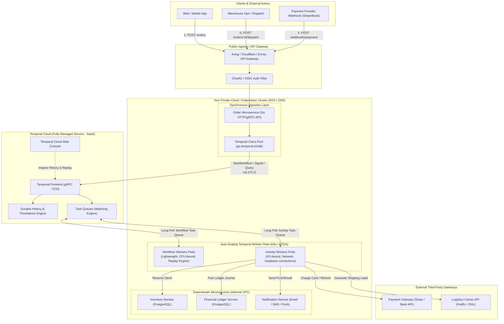
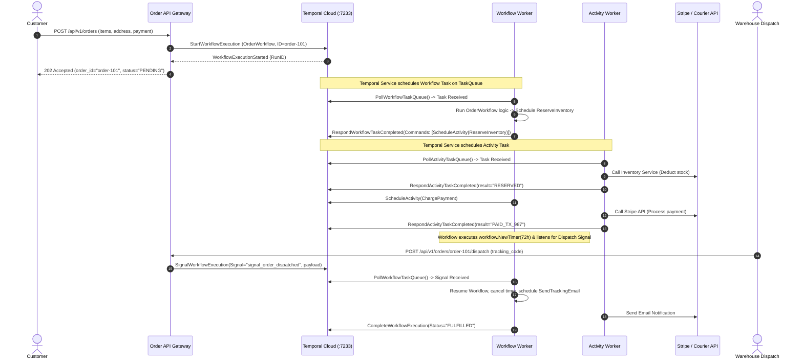
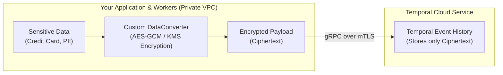
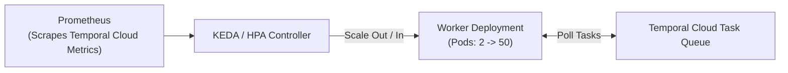

# Module 05: Production Architecture Design for Temporal

> **Architecture Context:** Enterprise-grade distributed system implementation without managing a local Temporal cluster, using **Temporal Cloud (Managed Service)** and an auto-scaling Go Worker Fleet in your private cloud / Kubernetes cluster.

---

## 1. System Architecture Blueprint

This architecture implements Temporal in an **Order-to-Cash, Payment Settlement, and Logistics Fulfillment Engine**. It coordinates multiple independent microservices and third-party APIs with zero loss of state, automated retries, distributed compensations (Saga), and human-in-the-loop webhooks.

---

## 2. End-to-End Sequence Diagram

This sequence illustrates the separation of concerns:
1. **The Ingestion API** accepts requests synchronously and returns immediately (`202 Accepted` with `OrderID` and `WorkflowID`).
2. **Temporal Cloud** schedules tasks and maintains durable state.
3. **Your Workers** execute business logic and activities asynchronously.
4. **External Webhooks** deliver signals without polling databases.

---

## 3. Structural Layers & Responsibilities

### Layer 1: Ingestion & API Layer (Synchronous)
- **Role:** Expose REST/GraphQL/gRPC APIs to mobile apps, web portals, and webhooks.
- **Responsibility:**
  - Fast request validation (schema, authentication, rate limiting).
  - Generate idempotent `WorkflowID` (e.g. `order-{order_uuid}` or `payment-{idempotency_key}`).
  - Start the workflow via `client.ExecuteWorkflow()`.
  - Return HTTP `202 Accepted` or `200 OK` with the `WorkflowID` in **< 50 milliseconds**.
- **Important Rule:** The API Gateway does **NOT** wait for long-running steps to complete. It hands off coordination to Temporal.

### Layer 2: Orchestration Layer (Temporal Cloud - SaaS)
- **Role:** Managed State Machine & Event Sourcing Engine.
- **Responsibility:**
  - Manages the Event History (append-only ledger of every step).
  - Delivers tasks to workers using reliable Task Queues.
  - Automatically handles worker retries, timeouts, and heartbeat liveness tracking.
  - **Zero local database or cluster maintenance required on your end.**

### Layer 3: Worker Fleet (Your Private Kubernetes Cluster)
- **Role:** Execute deterministic workflows and non-deterministic activities.
- **Topology Recommendation (Separated Queues):**
  - **Workflow Workers:** Stateless, CPU-efficient pods. They only execute the workflow replay and state machine logic.
  - **Activity Workers:** I/O heavy pods with database connection pools, third-party API credentials, and network connectivity to payment processors and internal services.
  - **Decoupling Benefit:** If external payment APIs slow down, activity workers can scale up independently without impacting workflow orchestration.

---

## 4. Security & Data Privacy Architecture

> [!IMPORTANT]
> **Data Privacy in Temporal Cloud:** Temporal Cloud **never** needs to see or store your plaintext customer data, credit card numbers, or PII.

### 1. Transport Security: Mutual TLS (mTLS)
- All traffic between your workers, API gateway, and Temporal Cloud is encrypted using **TLS 1.3**.
- Mutual certificate authentication guarantees only authorized workers can poll queues or submit results.

### 2. Client-Side Payload Encryption (DataConverter Pattern)
- Implement a custom `converter.PayloadCodec` in the Go SDK.
- The SDK automatically encrypts activity arguments and workflow results using your AWS KMS / HashiCorp Vault / Google Cloud KMS keys **before sending them over the wire**.
- Temporal Cloud only stores encrypted ciphertext. Even Temporal engineers cannot read your business payloads.
- Your worker automatically decrypts payloads when reading them into memory.

---

## 5. Failure Modes & Self-Healing Matrix

| Failure Scenario | Traditional Architecture Impact | Temporal Architecture Behavior |
| :--- | :--- | :--- |
| **Worker Pod Crashes (OOM / Node Restart)** | In-flight state lost; transaction hangs; manual cleanup required. | Temporal detects missed heartbeat; re-routes task to another healthy worker pod; worker **replays history** and resumes instantly. |
| **Downstream Payment API Outage (2 hours)** | Threads block, queues fill, HTTP timeouts crash upstream microservices. | Temporal pauses execution and applies exponential backoff retry. Workflow stays alive for hours/days without consuming resources. When payment recovers, execution proceeds smoothly. |
| **Network Partition between Worker and Cloud** | Unknown transaction state; risk of double charging. | Temporal Task Queue uses lease locks. Only one worker can hold an active task token. No duplicate executions. |
| **Subsequent Step Fails (e.g. Out of Stock)** | Partial state in DB; customer charged but no product delivered. | Triggers **Saga Compensation**: automatically invokes refund activity and restores state in reverse order using `workflow.NewDisconnectedContext`. |
| **Buggy Workflow Code Deployed** | Historical workflows crash due to code mismatch. | Safe deployment using `workflow.GetVersion()`. Historical workflows follow legacy branch; new workflows follow the new branch. |

---

## 6. Auto-Scaling Blueprint (KEDA / Kubernetes HPA)

In production on Kubernetes, you can autoscale your Activity and Workflow workers dynamically based on Temporal Task Queue backlog:

### Autoscaling Metrics to Target:
1. `temporal_activity_schedule_to_start_latency`: Time an activity waits in the queue before a worker picks it up. If latency > 2s, scale out worker pods.
2. `temporal_workflow_task_schedule_to_start_latency`: Latency for workflow decisions. If latency > 500ms, scale out workflow worker pods.

---

## 7. Implementation Checklist for Software Engineers

- [x] **Client Setup:** Universal config supporting mTLS and API keys in [`config/client.go`](file:///home/umesh-pc/Desktop/workspace/temporal/config/client.go).
- [x] **Deterministic Workflows:** Clean separation of orchestration in `internal/*/workflow.go`.
- [x] **Resilient Activities:** Retries, non-retryable errors, and heartbeats in `internal/*/activity.go`.
- [x] **Zero-Server Testing:** 100% in-memory verification using `testsuite` in `internal/*/*_test.go`.
- [x] **Worker Process:** Production-ready worker entrypoint in [`cmd/worker/main.go`](file:///home/umesh-pc/Desktop/workspace/temporal/cmd/worker/main.go).
- [x] **Ingestion & CLI:** Starter and signal dispatcher in [`cmd/starter/main.go`](file:///home/umesh-pc/Desktop/workspace/temporal/cmd/starter/main.go).
